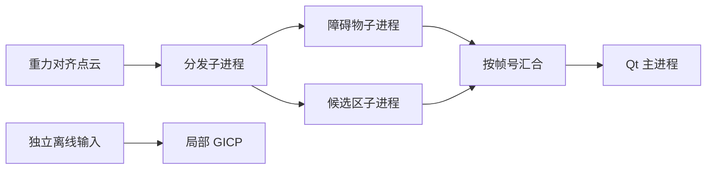

# LiDAR Perception Workbench

Point-cloud geometry, observed landing candidates, bounded multiprocessing and optional ROS/Qt/GICP adapters.

**点云几何 · RANSAC · DBSCAN · 2.5D 栅格 · 多进程 · Qt/OpenGL**

依据实际项目处理流程重新组织的公开展示代码，侧重算法核心、数据契约与软件结构。原始工程未直接上传；示例使用合成数据和通用接口。展示版不是原系统完整复现，也不附带原系统性能指标。

## 能看到什么

| 模块 | 内容 |
|---|---|
| 预处理 | 有限点过滤与体素质心 |
| 地面与障碍 | 法向约束 RANSAC、DBSCAN、水平主轴包围盒与几何规则 |
| 候选区域 | 高度统计、未知格拒绝、圆形腐蚀、区域平整性和距离排序 |
| 进程协作 | spawn 分发/障碍/候选区三个子进程，有界队列与按帧汇合 |
| Qt/OpenGL | 定时器非阻塞获取结果，点云和候选圆环显示 |
| ROS 1 | 标准 PointCloud2 接入，要求上游重力对齐 |
| 可选配准 | 局部 GICP、IMU 旋转初值、质量门限与失败回退 |

## 数据流



## 目录

```text
src/lidar_workbench/geometry.py   预处理、RANSAC、DBSCAN、包围盒
src/lidar_workbench/landing.py    栅格统计与候选区
src/lidar_workbench/pipeline.py   子进程与结果关联
src/lidar_workbench/odometry.py   独立局部 GICP
src/lidar_workbench/synthetic.py  合成点云
adapters/                        Qt/OpenGL 与 ROS 1
tests/                           几何与结果身份检查
docs/  架构、重构记录与公开范围
```

## 阅读与尝试

核心需要 Python 3.10+ 与 NumPy；`.[fast]` 提供 SciPy 加速，`.[viewer]` 提供 Qt/OpenGL，`.[registration]` 提供 Open3D。GUI 入口是 `python adapters/qt_viewer.py`，ROS 入口是 `adapters/ros1_bridge.py`。

```bash
python -m pip install -e .
lidar-workbench-demo
python -m unittest discover -s tests -v
```

以上是使用入口，实际验证范围见下节，不表示所有可选集成都已跑通。

## 验证范围

4 项几何和结果配对检查、合成点云 demo 已通过。多进程调度、Qt/OpenGL、ROS、SciPy 加速、Open3D GICP 未做本次运行验证，不提供实际场景或板端性能声明。

## 实现边界

候选区域仅满足当前观测的几何条件，不是飞行安全结论。未建模材质、承载、隐藏障碍和路径可达性。几何规则不是神经语义分类，局部 GICP 不是回环 SLAM 或紧耦合惯导。NumPy 回退适合阅读与小样例，大点云需加速依赖和资源评估。

## 设计文档

- [架构与算法](docs/architecture.md)
- [重构记录](docs/refactoring.md)
- [公开内容与脱敏范围](docs/public-scope.md)
- [第三方依赖](THIRD_PARTY.md)

## 相关展示仓库

- [Multisensor Acquisition Studio](https://github.com/leeeeeonzrz/multisensor-acquisition-studio)
- [RGB-D Phenotyping Toolkit](https://github.com/leeeeeonzrz/rgbd-phenotyping-toolkit)
- [Visual & Terrain Localization](https://github.com/leeeeeonzrz/visual-terrain-localization)
