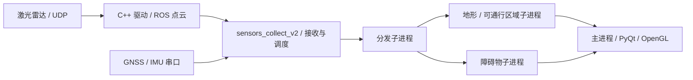

# 激光雷达点云实时处理系统

面向点云采集、几何处理、障碍物分析、地形可通行区域检测和三维显示的 ROS 工程。公开版本保留 C++ 雷达驱动、Python / Open3D 处理模块、PyQt 界面、OpenGL 显示、多进程调度和离线里程计实验代码。

## 实时处理结构

原应用显式创建三个工作子进程，此外还有 GUI 主进程和独立的 ROS 驱动进程。进程间主要通过 `multiprocessing.Queue` 传递数据；这并不意味着所有点云传输都是零拷贝。

## 原工程入口

| 文件或目录 | 内容 |
| --- | --- |
| [run_process_qt_lidar.sh](run_process_qt_lidar.sh) | 加载 ROS / 当前工作空间并启动原处理 launch |
| [qt_imu_gps_lslidar_process.launch](src/lslidar_ls_driver/launch/qt_imu_gps_lslidar_process.launch) | C++ 驱动与 Qt 处理应用的主要启动入口 |
| [sensors_collect_v2.py](src/lslidar_ls_driver/scripts/sensors_collect_v2.py) | 采集、分发、工作进程、界面事件与实时显示 |
| [MainWindow.ui](src/lslidar_ls_driver/scripts/MainWindow.ui) | 原始 Qt Designer 界面；同目录保留生成的 Python 界面文件 |
| [LandRecog2.py](src/lslidar_ls_driver/scripts/LandRecog2.py) | 地形/候选区域识别与几何筛选 |
| [ObstacleRecog.py](src/lslidar_ls_driver/scripts/ObstacleRecog.py) | 点云预处理、地面/障碍物划分及聚类分析 |
| [voxel_to_landarea.py](src/lslidar_ls_driver/scripts/voxel_to_landarea.py) | 体素与区域分析的实验实现 |
| [lidar_imu_odometry_landingzone_node.py](src/lslidar_ls_driver/scripts/lidar_imu_odometry_landingzone_node.py) | 离线数据读取、IMU 旋转先验、GICP 与局部地图分析 |
| [input.cc](src/lslidar_ls_driver/src/input.cc) | 驱动网络输入；同目录保留驱动解包与 ROS 发布 |

## 算法与软件设计

**几何预处理与分类。** 保留体素降采样、RANSAC 平面拟合、DBSCAN 聚类、包围盒与空间几何筛选。降采样控制点数，平面模型分离近似地面，聚类把剩余点组成候选区域；类别判别主要依赖几何条件，不能据此认定存在训练好的通用语义识别模型。

**地形分析。** 相关脚本利用局部高度、法向、区域连通性及栅格/体素表达筛选平整空间。候选区域描述的是观测数据支持的几何条件，算法中的阈值、邻域关系和处理分支保留原实现。

**里程计与局部地图。** 离线脚本使用传感器文件与点云序列，对 IMU 相邻姿态变化进行坐标变换，构造配准初值，再通过点云配准估计相对位姿并维护局部地图。这些脚本与实时 GUI 入口分别保留，未人为合并为同一条运行流程。

**并发与界面。** 实时应用保留 ROS 接收、工作进程创建、队列分发、信号槽、定时刷新、三维图层更新以及退出处理。`sensors_collect_v2_0.py`、`sensors_collect_v2 (copy)45.py` 和多版障碍物脚本是原有实验版本，保留名称和差异供阅读。

**网络输入。** 驱动包含 UDP 接收、包解析和点云组帧。`input.cc` 中同时存在 epoll 相关代码与 `poll` 路径，需结合编译分支判断实际启用方式；不能仅凭创建了 epoll 对象就宣称所有接收均由 epoll 驱动。

## 依赖与运行边界

原工程涉及 ROS 1 / catkin、C++、Python、PyQt5、pyqtgraph / OpenGL、Open3D、NumPy、SciPy、串口与 YAML。保留 `.spec` 打包配置、ROS 消息/服务、launch 和 RViz 配置；编译输出、打包产物、数据集和实验记录未上传。

公开版地址使用 `192.0.2.x` 文档示例值，需通过原 launch/ROS 参数配置实际设备；数据目录改为相对路径。实测 `T_imu_lidar` 外参已移除，离线节点通过必填 ROS 参数读取本地标定的 4×4 变换矩阵。此参数缺失时应先补配置。

`realtime_perception_system.launch` 引用的 `sensors_collect_odomtry_landing_v3.py` 不在现有材料中，保留该 launch 并明确此缺项。本次未连接雷达、复现目标平台环境或运行完整实时链路。

进一步查看 [源码索引](docs/SOURCE_INDEX.md)、[脱敏与版本边界](docs/PUBLICATION_NOTES.md)、[第三方来源](THIRD_PARTY.md)。
